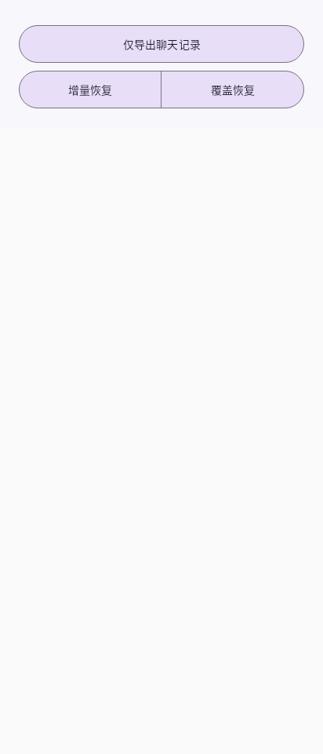
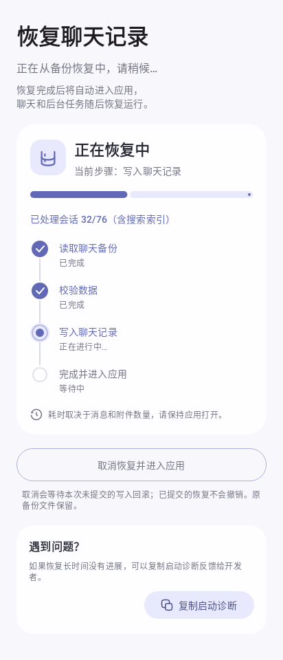
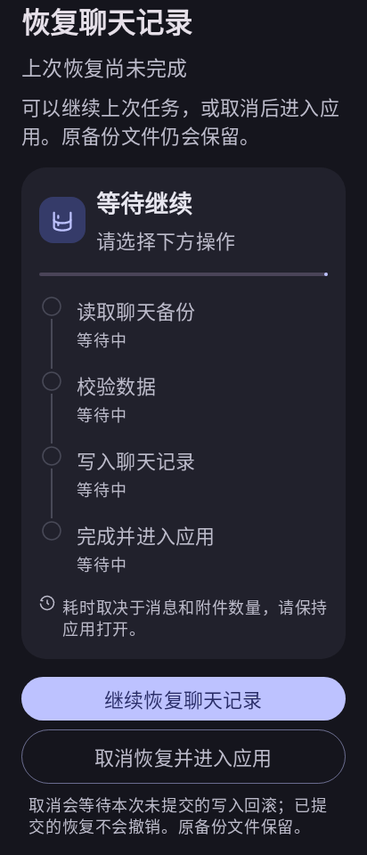

# 聊天备份与恢复界面验收（2026-10-21）

## 已完成

- “仅聊天记录”操作改为两行胶囊：第一行“仅导出聊天记录”；第二行等宽“增量恢复丨覆盖恢复”。保持原有动作、忙碌禁用状态与覆盖确认。
- 恢复页采用参考图的淡紫配色、圆角进度卡片、四步时间线、整行取消按钮和诊断卡片，支持深色及大字体滚动。
- 读取、校验、写入、完成步骤由实际恢复阶段驱动。显示已完成附件/会话数量；进度条表示当前操作进度，没有编造总百分比或剩余时间。
- 取消文案说明等待未提交写入回滚，保留原备份。保留新任务显示界面后自动恢复、中断任务手动继续的已有流程。

## 验证

- `restore-ui-final-tests.log`：7 组 55 项，失败/错误/跳过均为 0，`BUILD SUCCESSFUL in 38s`。
- 覆盖真实 Application/Koin/Room 启动链、1000 消息节点自动恢复、手动继续、取消回滚、错误路径、同 ID 会话恢复规则和附件持久化。
- UI 测试检查两行几何位置、等宽恢复操作、回调、禁用状态、真实进度文案、深色 1.5 倍字体滚动、取消中状态。
- Native Robolectric 的 Compose 实际绘制截图已检查。截图为主机渲染，真机视觉和本次新版恢复仍待用户验收。
- `git diff --check` 通过；`restore-ui-verification.json` 记录 92 个源码文件和 8 个历史命名 APK 的哈希。

## 预览

## 构建状态

构建完成：`OrangeChat-BackupUI-20261021-arm64.apk`，89,292,638 字节。`assembleDebug` 成功，用时 1 分 40 秒。

包名 `me.rerere.orangechat.liquidglass`，版本 2.2.4 / 160，ARM64，最低 Android 8.0。签名验证通过且与此前一致，证书 SHA256 为 `ff516315e577235b64ff356dbc856c053b7e589ae636dd8bc4301e528b46d116`。

APK SHA256：`e7f83367854913c2a57fd200c9079da005aa1f1a065dec3cda30ad1c3e3ebc51`。

OCR 打包检查、DEX 新 UI/自动恢复/五模块摘要检查均通过。92 个源码文件及 8 个历史命名 APK 无哈希漂移，证据见 `.codex/ui-review-20261020/restore-ui-apk-delivery.json`。

历史白屏的确切原因仍未确认；本次未操作手机或真实聊天数据。真机效果待验收。
